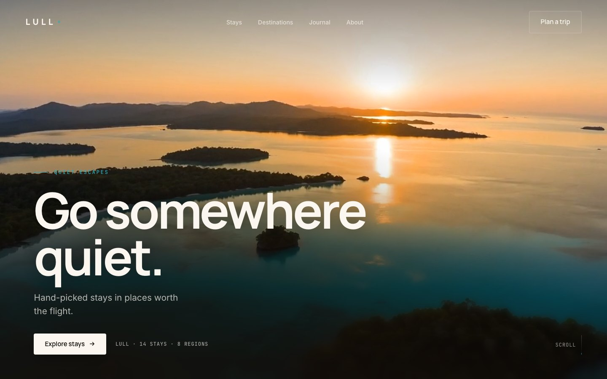
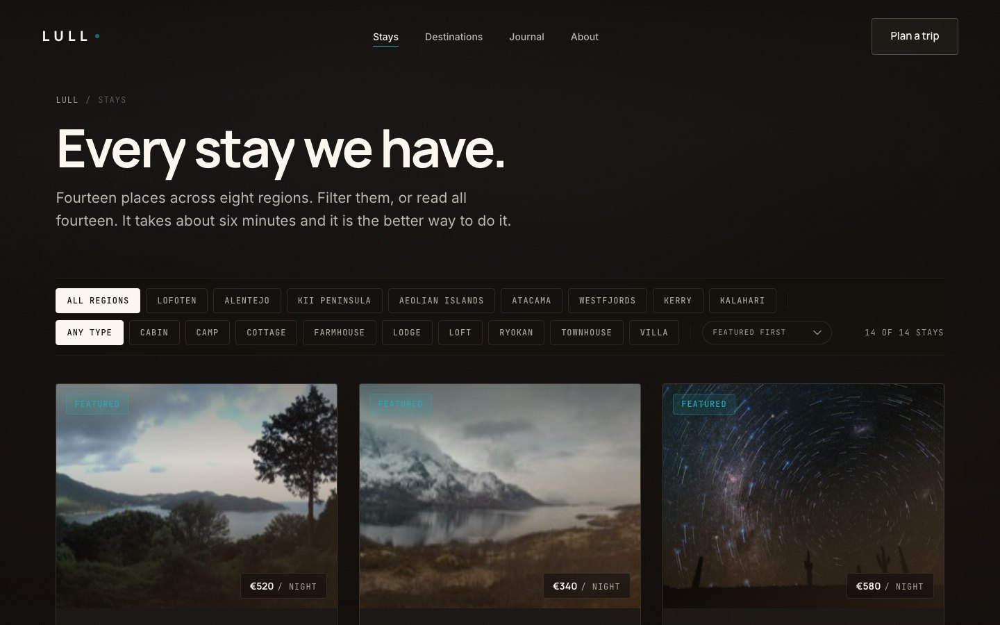
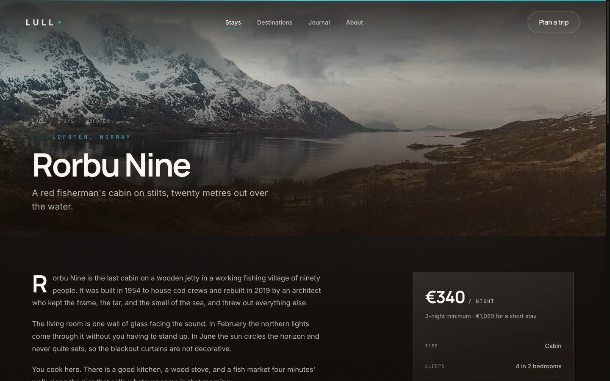
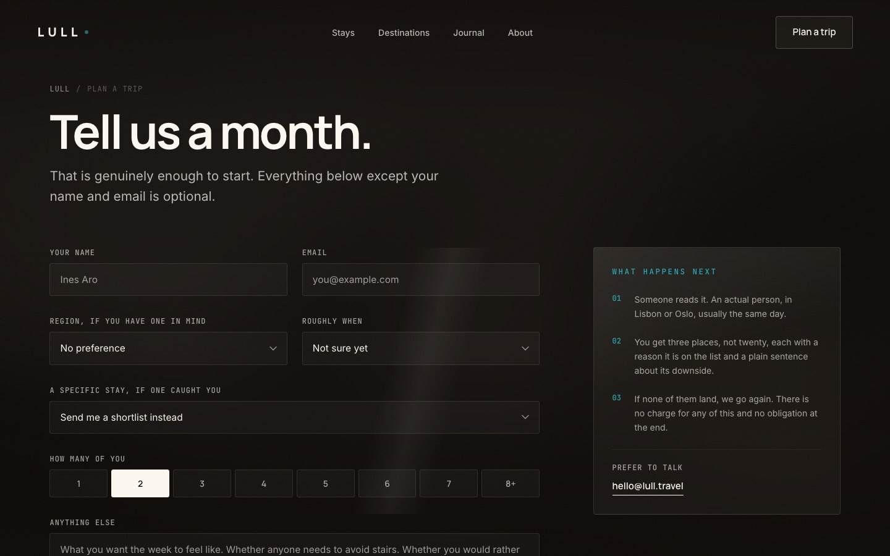
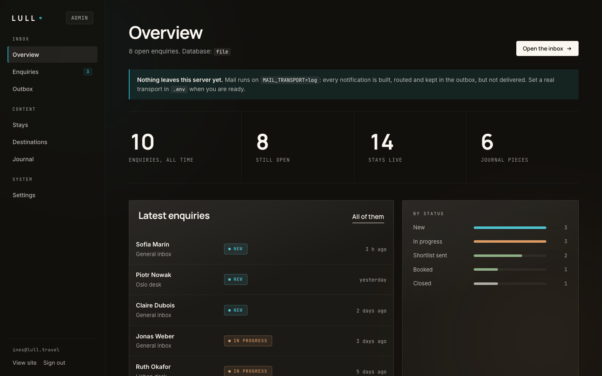
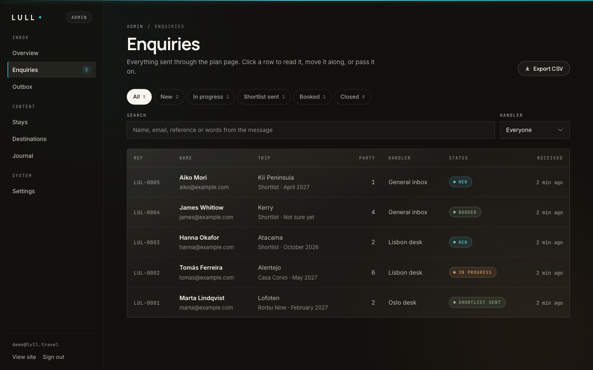
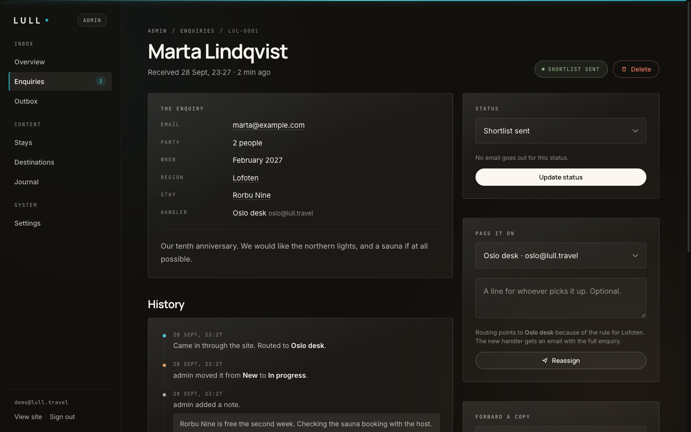
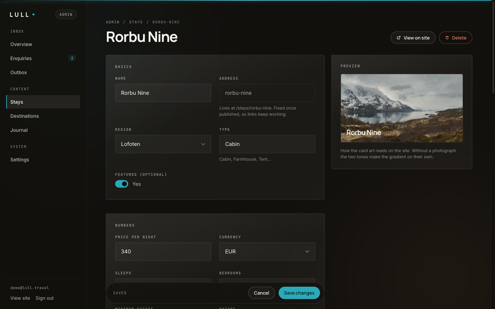
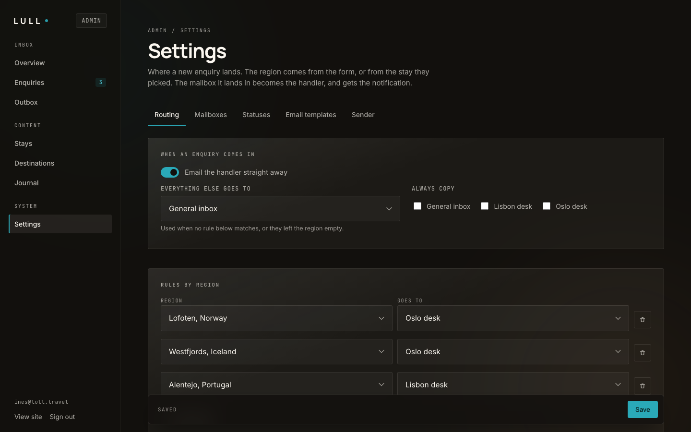
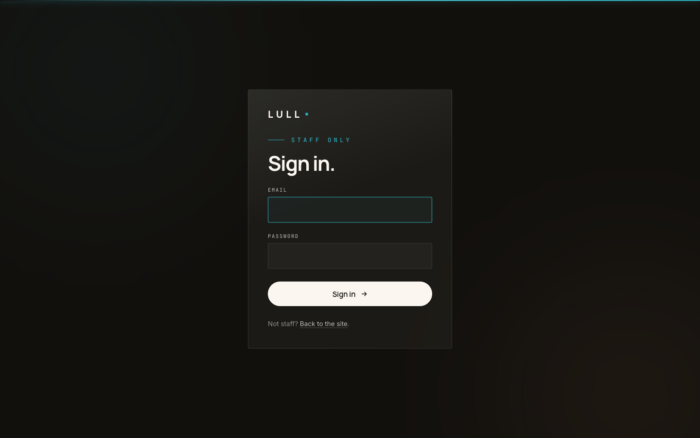

# LULL

[Polski](README.md) · **English**

> Hand-picked stays in quiet, out-of-the-way places.

LULL is a boutique travel agency website with a lightweight admin panel. The public part shows 14 carefully
chosen places in 8 regions of the world, a journal and an enquiry form. The panel at `/admin` lets the team handle
enquiries, edit content and set who gets which emails.

It is Node + Express and a static frontend in plain HTML, CSS and ES modules. No framework, no bundler, no build
step. The only production dependency is `express`.



## Who it is for

- **A small travel agency or a team of 2-5 people** that sells through conversation, not a shopping cart. The
  client leaves an enquiry, a specific person reads it and replies. The system makes sure the enquiry reaches the
  right inbox and nothing gets lost.
- **Developers and agencies** looking for a starting point for a site with an offer catalog and a CMS, without the
  upkeep of Next.js, WordPress or a headless CMS. The code can be read in one afternoon.
- **Integrators** who want to pull the catalog through an API or send enquiries from another source - full
  documentation in [`docs/api-documentation.pdf`](docs/api-documentation.pdf).

It is not a booking system: there are no payments, availability calendar or client accounts. That is a deliberate
choice.

## How it works

```
Browser ──► Express ──► static files (public/)
              │
              ├──► /api/*        public JSON API (catalog, journal, enquiries)
              ├──► /api/admin/*  panel API, behind login
              └──► /admin        panel (JS app, no framework)
                      │
                db/ layer ──► Supabase (Postgres in the cloud)
                          └─► JSON files (local mode, no configuration)
```

**Content** (stays, regions, articles) is loaded from the database at server start and kept in memory. Saving in
the panel writes to the database and memory at the same time, so the site shows the change right away, without a
restart. On the first run against an empty database the content is seeded from `server/data/*.json`.

**Enquiries** go like this:

1. The client fills in the form at `/plan` → `POST /api/enquiries` → server-side validation.
2. Routing assigns the enquiry to an inbox by region (e.g. Lofoten → Oslo desk). When no rule matches, the enquiry
   goes to the default inbox.
3. The enquiry is saved with the first status on the list (*New* by default).
4. The handler gets an email with the full enquiry (Reply-To = client), and the client gets a confirmation
   (Reply-To = handler).
5. In the panel the team changes statuses, hands the enquiry to another inbox, sends a copy outside and adds notes.
   Each of these lands in the enquiry history.

**Emails** run in `log` mode by default: each one is fully built and saved in the panel's Outbox, but nothing leaves
the server. Real sending is switched on with one variable in `.env` (a ready Resend adapter, SMTP is easy to add).

## Features

**Public site**

| Path | What it is |
|---|---|
| `/` | Video hero, manifesto, featured stays, counters, process, journal teaser |
| `/stays` | Grid with filters (region, type, sorting) reflected in the URL |
| `/stays/:slug` | Description, "the catch" (an honest downside), amenities, enquiry panel, similar places |
| `/destinations`, `/destinations/:slug` | Eight regions and their stays |
| `/journal`, `/journal/:slug` | Journal with a category filter, reading progress bar, previous/next |
| `/plan` | Enquiry form with server-side validation |
| `/about` | Principles, story, people |
| `/credits` | Photo authors and licenses |

**The `/admin` panel**

- **Overview** - counters, enquiries by status, latest enquiries and emails.
- **Enquiries** - list with filters, search and CSV export, details with history and emails.
- **Stays / Destinations / Journal** - forms generated from a schema, card preview, validation.
- **Settings** - inboxes, routing rules, statuses (with client emails or team notes), email templates with
  placeholders and preview, sender, test email.
- **Outbox** - every email the system prepared, with information on whether it was sent.

## Screenshots

### Public site

| Stays catalog | Property page |
|---|---|
|  |  |

| Enquiry form |
|---|
|  |

### Admin panel

| Overview | Enquiry list |
|---|---|
|  |  |

| Enquiry details | Content editing |
|---|---|
|  |  |

| Enquiry routing | Login |
|---|---|
|  |  |

Panel data in the screenshots is sample data.

## Getting started

Requires Node.js 18 or newer.

```bash
npm install
cp .env.example .env    # fill in ADMIN_EMAIL, ADMIN_PASSWORD, SESSION_SECRET
npm run dev             # http://localhost:3000, panel: /admin
```

Without Supabase keys the app runs on local files in `server/data/` - nothing else is needed for local work. After
start the console shows which database and which email transport are active.

| Script | What it does |
|---|---|
| `npm start` | Production server |
| `npm run dev` | Server with automatic restart on file changes |
| `npm run db:seed` | Resets content to the seed files (asks for `--yes` confirmation, does not touch enquiries) |

## Configuration

Everything in `.env` (template in `.env.example`, `.env` itself is in `.gitignore`).

| Variable | Description |
|---|---|
| `PORT` | Server port, default `3000` |
| `SITE_URL` | Full site address - canonical, Open Graph, sitemap and links in emails. **Set it before deploying.** |
| `TRUST_PROXY` | `1` behind a reverse proxy, otherwise all visitors share one rate limit |
| `ADMIN_EMAIL`, `ADMIN_PASSWORD` | Panel login. Empty = panel disabled |
| `SESSION_SECRET` | Key for signing sessions. Without it sessions are lost on restart |
| `SUPABASE_URL`, `SUPABASE_SECRET_KEY` | Cloud database. Empty = local files |
| `MAIL_TRANSPORT` | `log` (default, nothing is sent) or `resend` |
| `RESEND_API_KEY` | Resend key, when `MAIL_TRANSPORT=resend` |

### Database (Supabase)

1. Create a project at [supabase.com](https://supabase.com).
2. In the **SQL Editor** run the whole content of [`supabase/schema.sql`](supabase/schema.sql).
3. In `.env`: `SUPABASE_URL=https://<project-id>.supabase.co` and `SUPABASE_SECRET_KEY` (an `sb_secret_…` key or the
   older `service_role`). Don't use publishable/anon keys.
4. Restart the server - the console shows `database  supabase`.

Tables have RLS enabled with no policies: only the server key has access, never the browser.

## Structure

```
server/
  index.js          Express app, page routes, sitemap, robots
  db/               database drivers: supabase.js and file.js (same interface)
  lib/              store, enquiries (routing and handling), mail, settings, schema, auth, security, compression
  routes/           one router per resource, admin.js is the whole panel API
  views/            HTML templates for pages and the panel
  data/*.json       seed data - never overwritten at runtime
  scripts/seed.js   content reset
public/
  css/              base (tokens) → components → pages / admin
  js/               site ES modules, js/admin/ - the panel
  img/              photos in two widths
supabase/schema.sql database schema
docs/
  api-documentation.pdf / .html   API documentation for third parties
  admin.md                        how the panel, database and emails work, how to add endpoints
  screenshots/                    screenshots used in the README
```

## Security

- Session in an `HttpOnly; SameSite=Strict` cookie (+ `Secure` over HTTPS), HMAC-signed, valid for 12 hours.
- Constant-time password comparison, a limit of 10 login attempts per 15 minutes and 5 enquiries per hour per IP.
- Data-changing requests from a foreign `Origin` are rejected, CSP and `X-Frame-Options` headers, HSTS over HTTPS.
- Everything is validated on the server, all data inserted into HTML is escaped.
- The panel and its API are excluded from indexing and caching.

Rate limits are counted in process memory. With several instances you need a shared store (e.g. Redis).

## Performance

Text responses are brotli-compressed (`lib/compress.js` for HTML/JSON, `lib/staticText.js` for CSS and JS). Photos
are cached for a year and served in two widths through `srcset`. On `/stays`: 947 kB → 346 kB.

## Photos and licenses

Twenty-two place photos come from Wikimedia Commons under CC BY, CC BY-SA and public domain. Authors, licenses and
links to the originals are on the [`/credits`](server/views/credits.html) page, linked in the footer of every page.
The page data lives in `server/data/credits.json`, so replacing a photo means updating one entry.

The photos are toned in CSS, not in the files: `.art` in `public/css/base.css` applies a warm filter, a teal and
amber tint and grain to each one, so an Arctic fjord and a Kalahari sunset look like one shoot. Each record also has
`tone: [shadow, light]` - the color shown before the photo loads.

The three founder portraits are GAN-generated faces (thispersondoesnotexist.com) - the people shown do not exist.

## Documentation

- [`docs/api-documentation.pdf`](docs/api-documentation.pdf) - all public and panel endpoints, parameters, request
  and response examples, error codes.
- [`docs/admin.md`](docs/admin.md) - how the panel is built, Supabase and email configuration, a recipe for a new
  endpoint.

## License

Code released under the MIT license, see [`LICENSE`](LICENSE). The license does not cover the Wikimedia Commons
photos, which have their own licenses listed on the `/credits` page.
