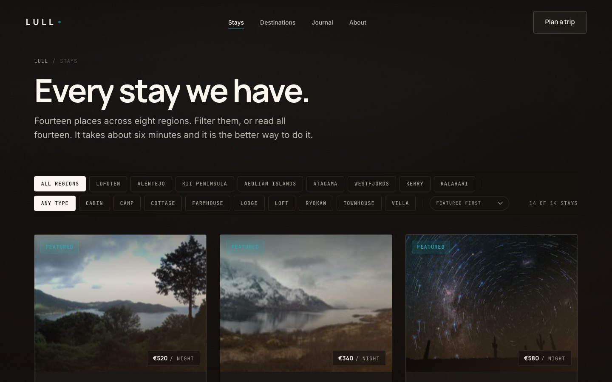
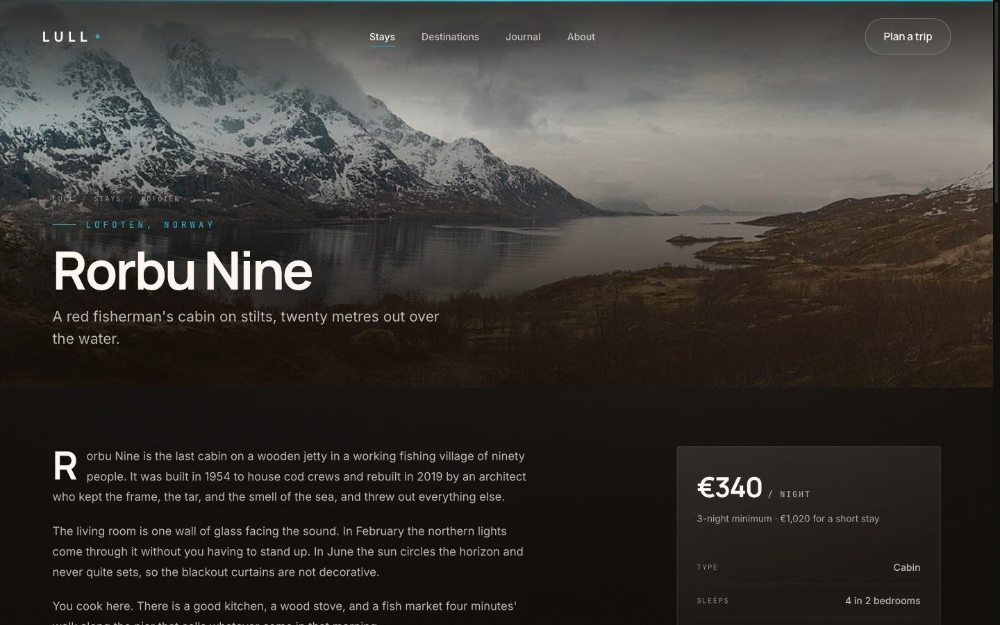
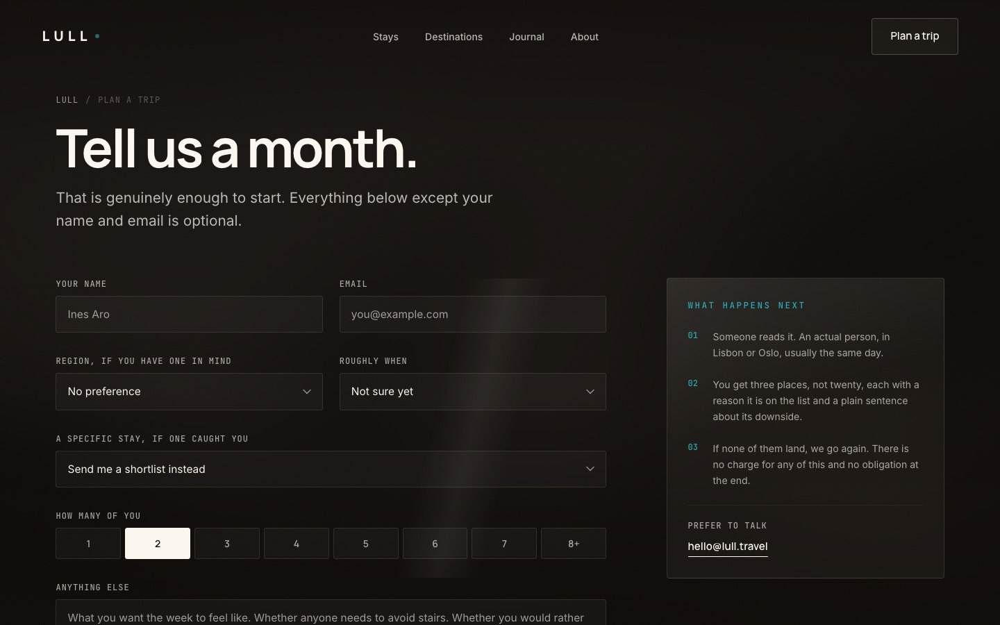
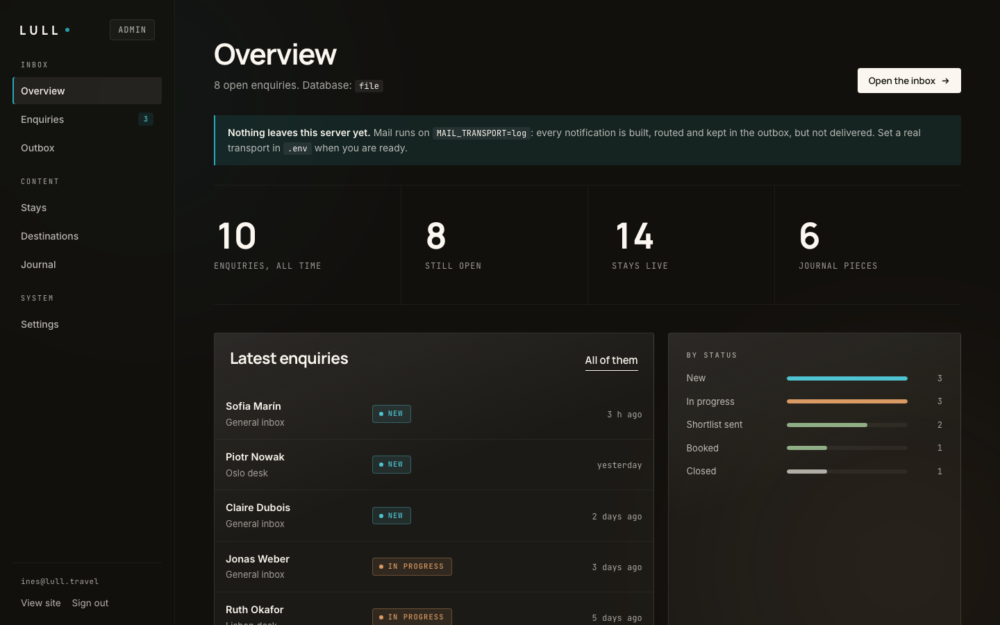
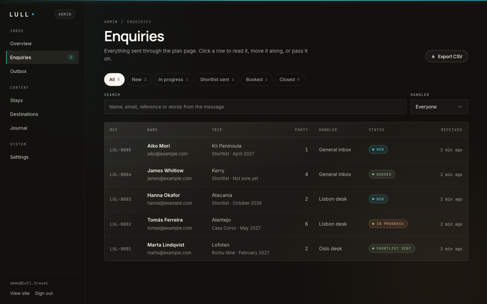
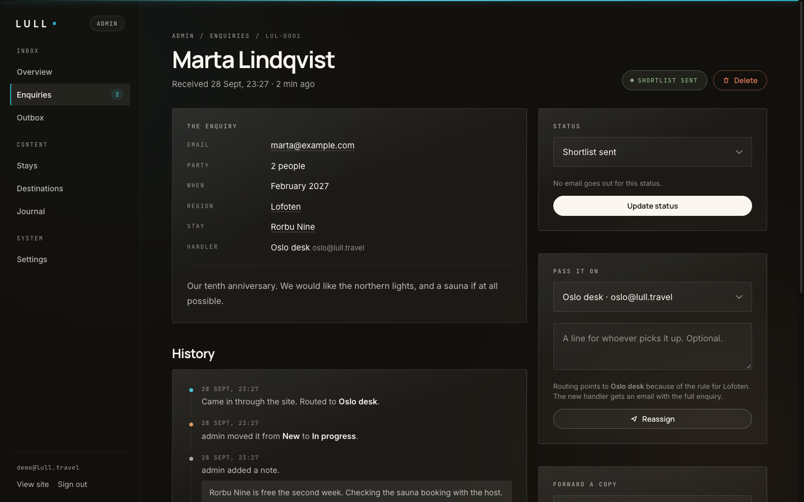
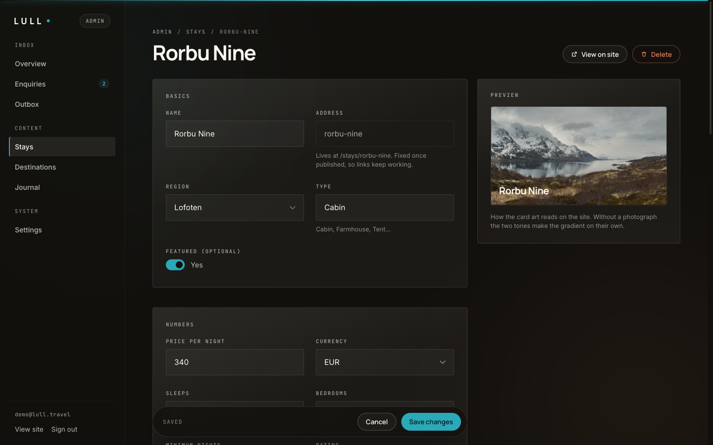
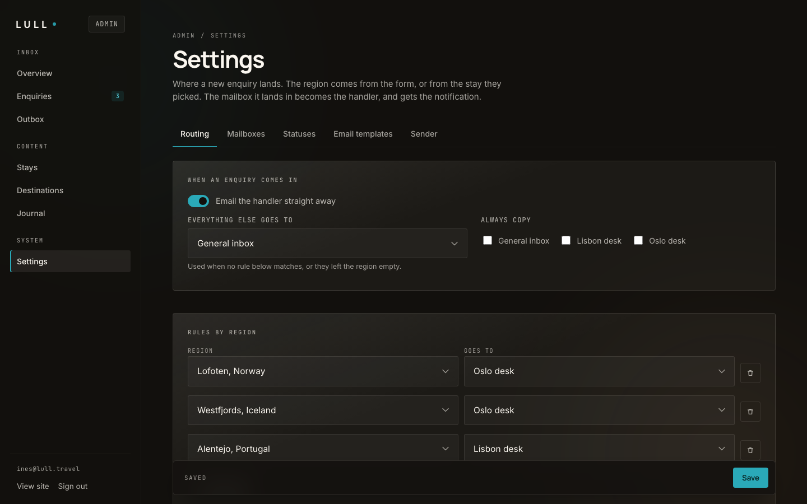
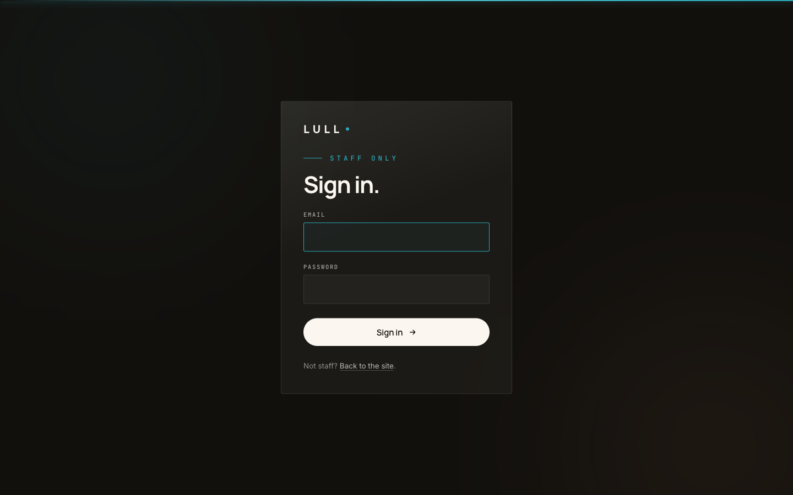

# LULL

**Polski** · [English](README.en.md)

> Hand-picked stays in quiet, out-of-the-way places.

LULL to strona butikowego biura podróży razem z lekkim panelem administracyjnym. Publiczna część pokazuje
14 starannie wybranych miejsc w 8 regionach świata, dziennik i formularz zapytań. Panel pod `/admin`
pozwala zespołowi obsługiwać zapytania, edytować treści i ustawiać, kto i jakie maile dostaje.

Całość to Node + Express i statyczny frontend w czystym HTML, CSS i modułach ES. Bez frameworka, bez
bundlera, bez kroku budowania. Jedyna zależność produkcyjna to `express`.


## Dla kogo

- **Dla małego biura podróży lub zespołu 2-5 osób**, który sprzedaje przez rozmowę, a nie przez koszyk.
  Klient zostawia zapytanie, konkretna osoba je czyta i odpisuje. System pilnuje, żeby zapytanie trafiło
  do właściwej skrzynki i żeby nic nie zginęło.
- **Dla deweloperów i agencji**, którzy szukają punktu wyjścia pod stronę z katalogiem ofert i CMS-em,
  ale bez kosztu utrzymania Next.js, WordPressa czy headless CMS-a. Kod da się przeczytać w jedno popołudnie.
- **Dla integratorów**, którzy chcą pobierać katalog przez API albo wysyłać zapytania z innego źródła -
  pełna dokumentacja w [`docs/api-documentation.pdf`](docs/api-documentation.pdf).

Nie jest to system rezerwacyjny: nie ma płatności, kalendarza dostępności ani kont klientów. To świadomy wybór.

## Jak to działa

```
Przeglądarka ──► Express ──► statyczne pliki (public/)
                   │
                   ├──► /api/*        publiczne JSON API (katalog, dziennik, zapytania)
                   ├──► /api/admin/*  API panelu, za logowaniem
                   └──► /admin        panel (aplikacja w JS, bez frameworka)
                           │
                     warstwa db/ ──► Supabase (Postgres w chmurze)
                                 └─► pliki JSON (tryb lokalny, bez konfiguracji)
```

**Treści** (stays, regiony, artykuły) są ładowane z bazy przy starcie serwera i trzymane w pamięci.
Zapis w panelu idzie jednocześnie do bazy i do pamięci, więc strona pokazuje zmianę od razu, bez restartu.
Przy pierwszym uruchomieniu na pustej bazie treści wgrywają się same z plików `server/data/*.json`.

**Zapytania** przechodzą taką drogę:

1. Klient wypełnia formularz na `/plan` → `POST /api/enquiries` → walidacja po stronie serwera.
2. Routing przypisuje zapytanie do skrzynki według regionu (np. Lofoten → Oslo desk). Gdy żadna reguła
   nie pasuje, zapytanie trafia do skrzynki domyślnej.
3. Zapytanie zapisuje się z pierwszym statusem z listy (domyślnie *New*).
4. Handler dostaje mail z całym zapytaniem (Reply-To = klient), a klient - potwierdzenie (Reply-To = handler).
5. W panelu zespół zmienia statusy, przekazuje zapytanie innej skrzynce, wysyła kopię na zewnątrz
   i dodaje notatki. Każda z tych rzeczy trafia do historii zapytania.

**Maile** domyślnie działają w trybie `log`: każdy jest w całości budowany i zapisywany w Outboxie panelu,
ale nic nie wychodzi z serwera. Prawdziwą wysyłkę włącza się jedną zmienną w `.env` (gotowy adapter
Resend; SMTP łatwo dopisać).

## Funkcje

**Strona publiczna**

| Adres | Co to jest |
|---|---|
| `/` | Hero wideo, manifest, wyróżnione stays, liczniki, proces, zajawka dziennika |
| `/stays` | Siatka z filtrami (region, typ, sortowanie) odzwierciedlanymi w URL |
| `/stays/:slug` | Opis, „the catch” (uczciwy minus), udogodnienia, panel zapytania, podobne miejsca |
| `/destinations`, `/destinations/:slug` | Osiem regionów i ich stays |
| `/journal`, `/journal/:slug` | Dziennik z filtrem kategorii, pasek postępu czytania, poprzedni/następny |
| `/plan` | Formularz zapytania z walidacją po stronie serwera |
| `/about` | Zasady, historia, ludzie |
| `/credits` | Autorzy i licencje zdjęć |

**Panel `/admin`**

- **Overview** - liczniki, zapytania według statusów, ostatnie zapytania i maile.
- **Enquiries** - lista z filtrami, wyszukiwarką i eksportem CSV; szczegóły z historią i mailami.
- **Stays / Destinations / Journal** - formularze generowane ze schematu, podgląd karty, walidacja.
- **Settings** - skrzynki, reguły routingu, statusy (z mailami do klienta lub notkami do zespołu),
  szablony maili z placeholderami i podglądem, nadawca, mail testowy.
- **Outbox** - każdy mail, jaki system przygotował, z informacją, czy wyszedł.

## Zrzuty ekranu

### Strona publiczna

| Katalog stays | Strona obiektu |
|---|---|
|  |  |

| Formularz zapytania |
|---|
|  |

### Panel administracyjny

| Overview | Lista zapytań |
|---|---|
|  |  |

| Szczegóły zapytania | Edycja treści |
|---|---|
|  |  |

| Routing zapytań | Logowanie |
|---|---|
|  |  |

Dane w panelu na zrzutach są przykładowe.

## Uruchomienie

Wymagany Node.js 18 lub nowszy.

```bash
npm install
cp .env.example .env    # uzupełnij ADMIN_EMAIL, ADMIN_PASSWORD, SESSION_SECRET
npm run dev             # http://localhost:3000, panel: /admin
```

Bez kluczy Supabase aplikacja działa na plikach lokalnych w `server/data/` - do pracy lokalnej nie trzeba
nic więcej. Konsola po starcie pokazuje, jaka baza i jaki transport maili są aktywne.

| Skrypt | Co robi |
|---|---|
| `npm start` | Serwer produkcyjny |
| `npm run dev` | Serwer z automatycznym restartem po zmianie plików |
| `npm run db:seed` | Reset treści do plików seed (pyta o potwierdzenie `--yes`; zapytań nie rusza) |
| `npm test` | Testy (`node:test`): zgoda i honeypot w formularzu, strony prawne, Open Graph, sitemap, favicon, 404 |

## Konfiguracja

Wszystko w `.env` (wzór w `.env.example`, sam `.env` jest w `.gitignore`).

| Zmienna | Opis |
|---|---|
| `PORT` | Port serwera, domyślnie `3000` |
| `SITE_URL` | Pełny adres strony - canonical, Open Graph, sitemap i linki w mailach. **Ustaw przed wdrożeniem.** |
| `TRUST_PROXY` | `1` za reverse proxy, inaczej wszyscy odwiedzający dzielą jeden limit żądań |
| `ADMIN_EMAIL`, `ADMIN_PASSWORD` | Logowanie do panelu. Puste = panel wyłączony |
| `SESSION_SECRET` | Klucz do podpisywania sesji. Bez niego sesje giną przy restarcie |
| `SUPABASE_URL`, `SUPABASE_SECRET_KEY` | Baza w chmurze. Puste albo nieosiągalne (np. wstrzymany projekt) = pliki lokalne, z ostrzeżeniem w konsoli |
| `MAIL_TRANSPORT` | `log` (domyślnie, nic nie wychodzi) lub `resend` |
| `RESEND_API_KEY` | Klucz Resend, gdy `MAIL_TRANSPORT=resend` |

### Baza danych (Supabase)

1. Utwórz projekt na [supabase.com](https://supabase.com).
2. W **SQL Editor** uruchom całą zawartość [`supabase/schema.sql`](supabase/schema.sql).
3. Do `.env`: `SUPABASE_URL=https://<project-id>.supabase.co` i `SUPABASE_SECRET_KEY` (klucz `sb_secret_…`
   albo starszy `service_role`). Nie używaj kluczy publishable/anon.
4. Zrestartuj serwer - w konsoli pojawi się `database  supabase`.

Tabele mają włączone RLS bez polityk: dostęp ma wyłącznie klucz serwerowy, nigdy przeglądarka.

## Struktura

```
server/
  index.js          aplikacja Express, trasy stron, sitemap, robots
  db/               sterowniki bazy: supabase.js i file.js (ten sam interfejs)
  lib/              store, enquiries (routing i obsługa), mail, settings, schema, auth, security, kompresja
  routes/           jeden router na zasób; admin.js to całe API panelu
  views/            szablony HTML stron i panelu
  data/*.json       dane seed - nigdy nie nadpisywane w trakcie działania
  scripts/seed.js   reset treści
public/
  css/              base (tokeny) → components → pages / admin
  js/               moduły ES strony; js/admin/ - panel
  img/              zdjęcia w dwóch szerokościach
supabase/schema.sql schemat bazy
docs/
  api-documentation.pdf / .html   dokumentacja API dla osób trzecich
  admin.md                        jak działa panel, baza i maile; jak dodawać endpointy
  screenshots/                    zrzuty ekranu używane w README
```

## Bezpieczeństwo

- Sesja w ciasteczku `HttpOnly; SameSite=Strict` (+ `Secure` po HTTPS), podpisana HMAC, ważna 12 godzin.
- Porównywanie hasła w stałym czasie; limit 10 prób logowania na 15 minut i 5 zapytań na godzinę z IP.
- Odrzucanie żądań zmieniających dane z obcego `Origin`; nagłówki CSP, `X-Frame-Options`, HSTS po HTTPS.
- Walidacja wszystkiego po stronie serwera, escapowanie wszystkich danych wstawianych do HTML.
- Panel i jego API są wyłączone z indeksowania i cache.

Limity żądań są liczone w pamięci procesu. Przy kilku instancjach potrzebny jest wspólny magazyn (np. Redis).

## Wydajność

Odpowiedzi tekstowe idą skompresowane brotli (`lib/compress.js` dla HTML/JSON, `lib/staticText.js` dla CSS
i JS). Zdjęcia są cache'owane na rok i serwowane w dwóch szerokościach przez `srcset`. Na `/stays`:
947 kB → 346 kB.

## Zdjęcia i licencje

Dwadzieścia dwa zdjęcia miejsc pochodzą z Wikimedia Commons na licencjach CC BY, CC BY-SA i z domeny publicznej.
Autorzy, licencje i linki do oryginałów są na stronie [`/credits`](server/views/credits.html), do której prowadzi
link w stopce każdej strony. Dane strony są w `server/data/credits.json`, więc po podmianie zdjęcia wystarczy
zaktualizować jeden wpis.

Zdjęcia są stonowane w CSS, a nie w plikach: `.art` w `public/css/base.css` nakłada na każde ciepły filtr,
turkusowo-bursztynowy odcień i ziarno, dzięki czemu fiord w Arktyce i zachód słońca w Kalahari wyglądają jak
jedna sesja. Każdy rekord ma też `tone: [cień, światło]` - kolor widoczny przed wczytaniem zdjęcia.

Trzy portrety założycieli to twarze wygenerowane przez GAN (thispersondoesnotexist.com) - przedstawione osoby
nie istnieją.

## Dokumentacja

- [`docs/api-documentation.pdf`](docs/api-documentation.pdf) - wszystkie endpointy publiczne i panelu,
  parametry, przykłady żądań i odpowiedzi, kody błędów.
- [`docs/admin.md`](docs/admin.md) - jak zbudowany jest panel, konfiguracja Supabase i maili, przepis na
  nowy endpoint.

## Licencja

Kod udostępniony na licencji MIT, szczegóły w pliku [`LICENSE`](LICENSE). Licencja nie obejmuje zdjęć z
Wikimedia Commons, które mają własne licencje wymienione na stronie `/credits`.
